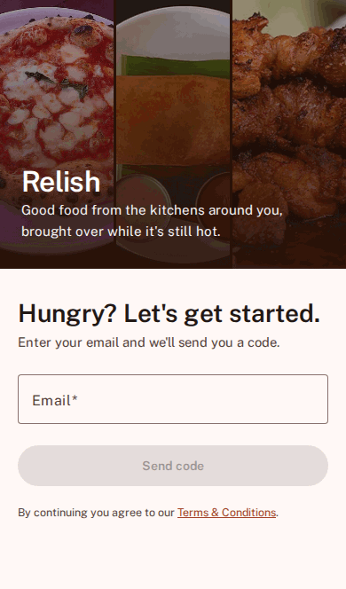
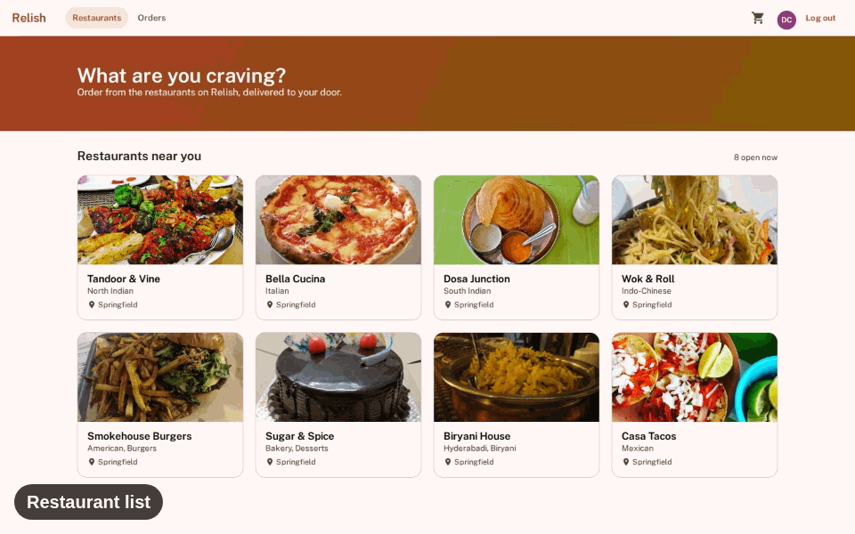
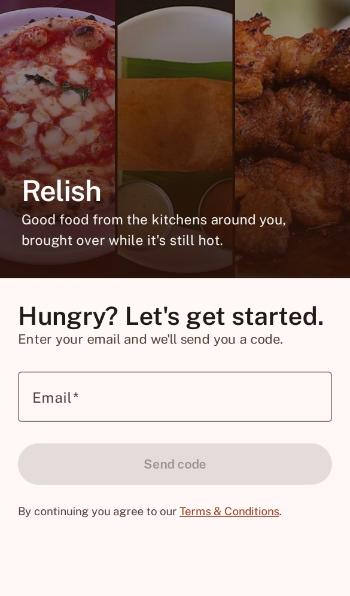
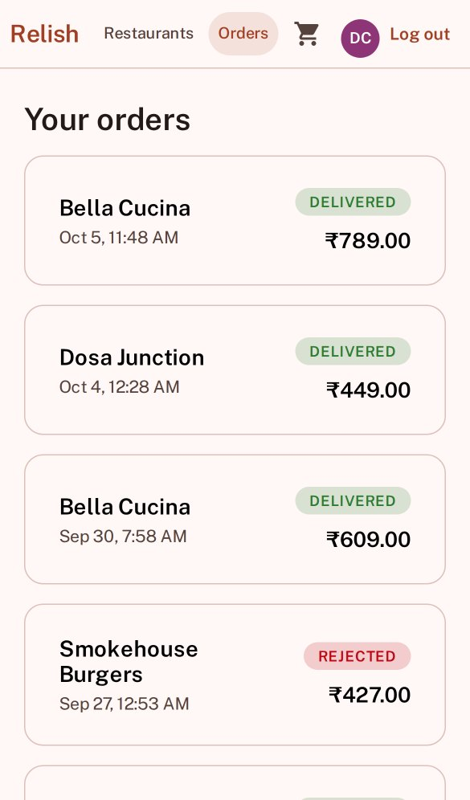
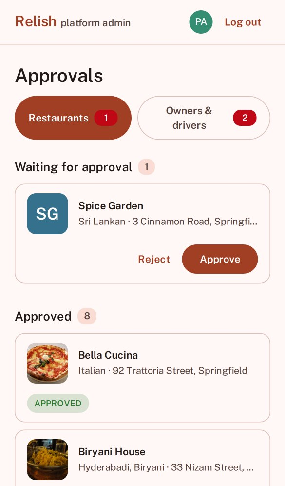

# Relish

[](https://github.com/thanecoder/relish-food-delivery-saas/actions/workflows/ci.yml)

Food delivery app built with Angular and Spring Boot. Customers order, restaurants run the queue, riders deliver and an admin approves new restaurants, all behind OTP login (no passwords). Everything runs in Docker.

## Screenshots

<p>
  
  
</p>

On a phone

<table>
  <tr>
    <td></td>
    <td></td>
    <td></td>
    <td></td>
    <td></td>
  </tr>
</table>

## Requirements

Just Docker (Desktop or Engine + compose plugin). No local Node, JDK, Maven or Postgres needed, everything builds and runs in containers.

## Quickstart

```bash
git clone https://github.com/thanecoder/relish-food-delivery-saas.git
cd food-delivery-saas
cp .env.example .env
docker compose up
```

Once it is up, open the frontend in your browser. The ports are in `docker-compose.yml` if you need to change them.

## Tests

```bash
docker compose --profile test run --rm backend-test
```

## License

MIT, see `LICENSE`. The food and restaurant photos come from Wikimedia Commons and keep their own licences, credits are in `CREDITS.md`.
