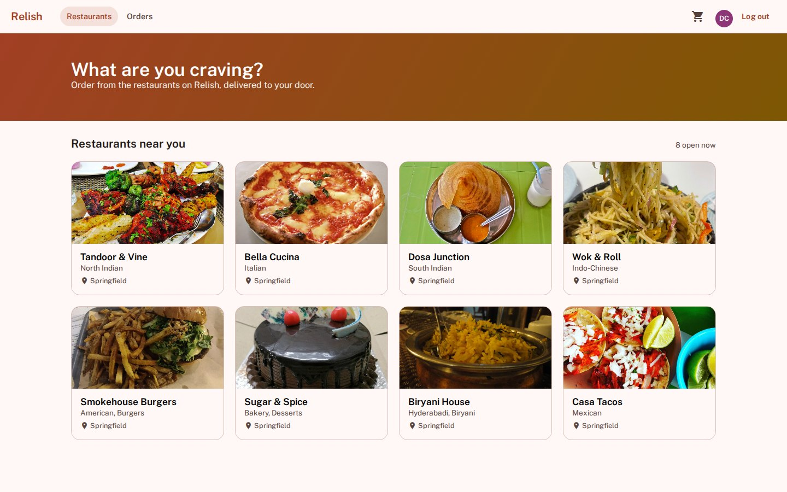
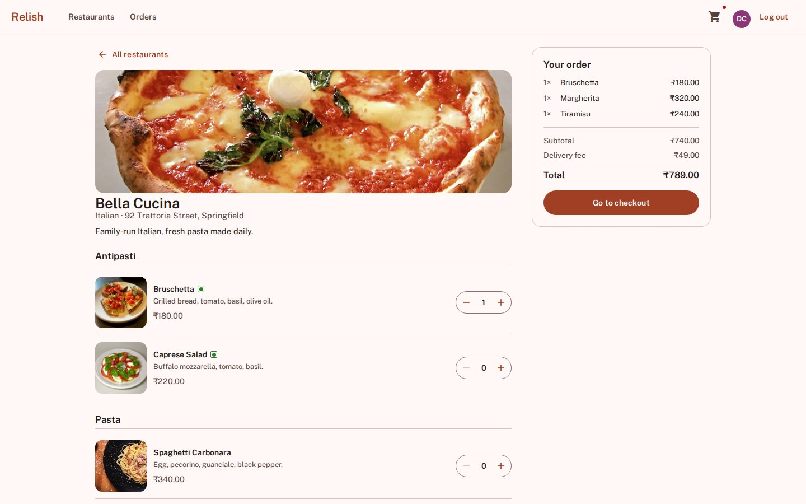
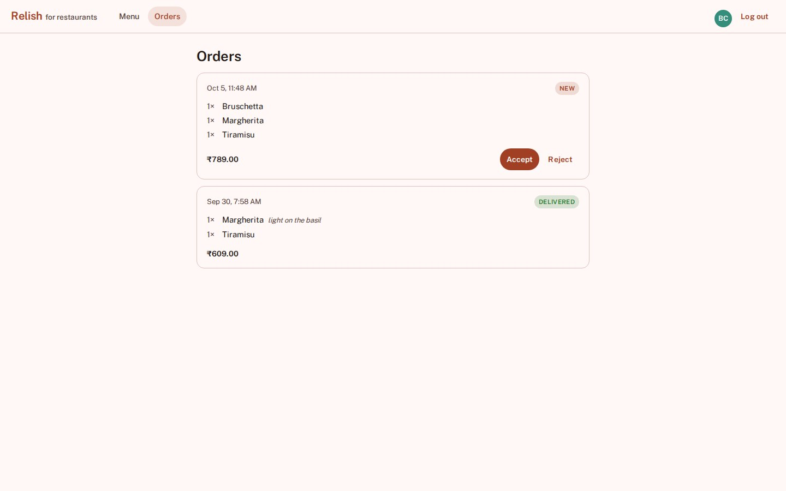
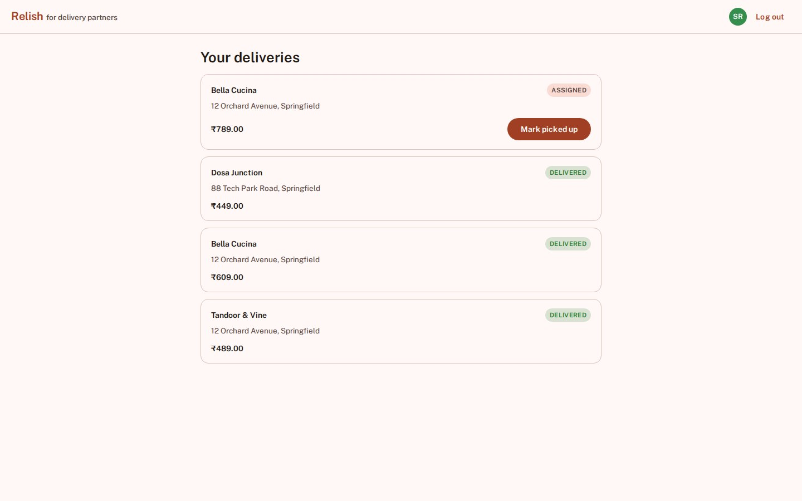
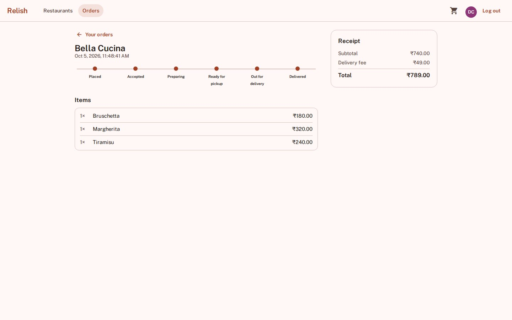
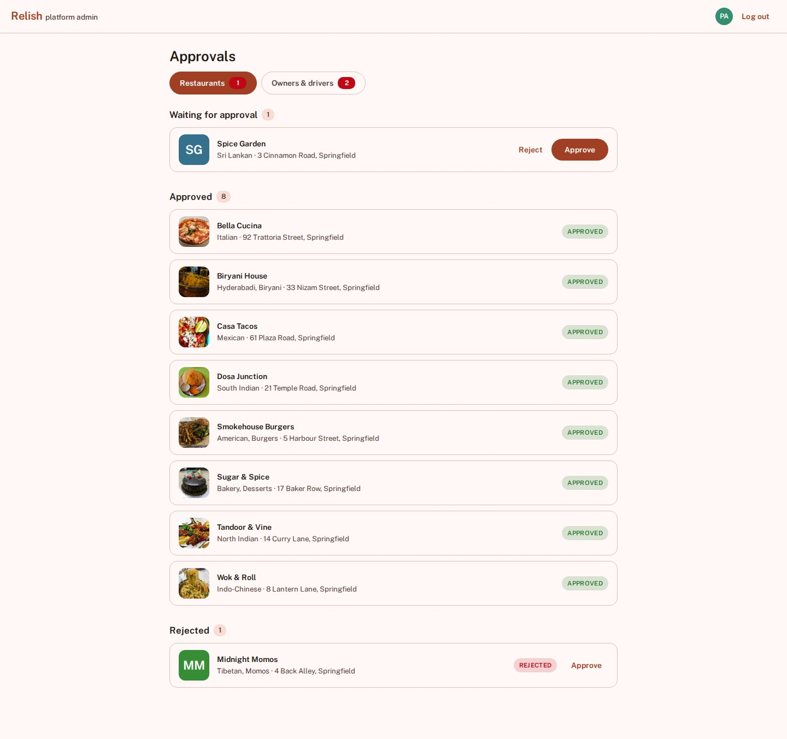
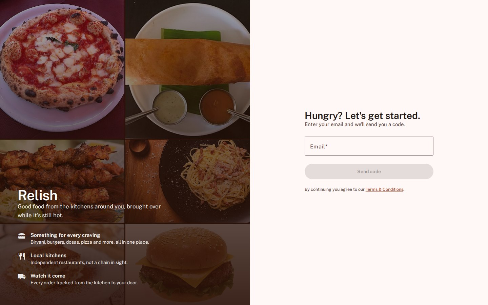
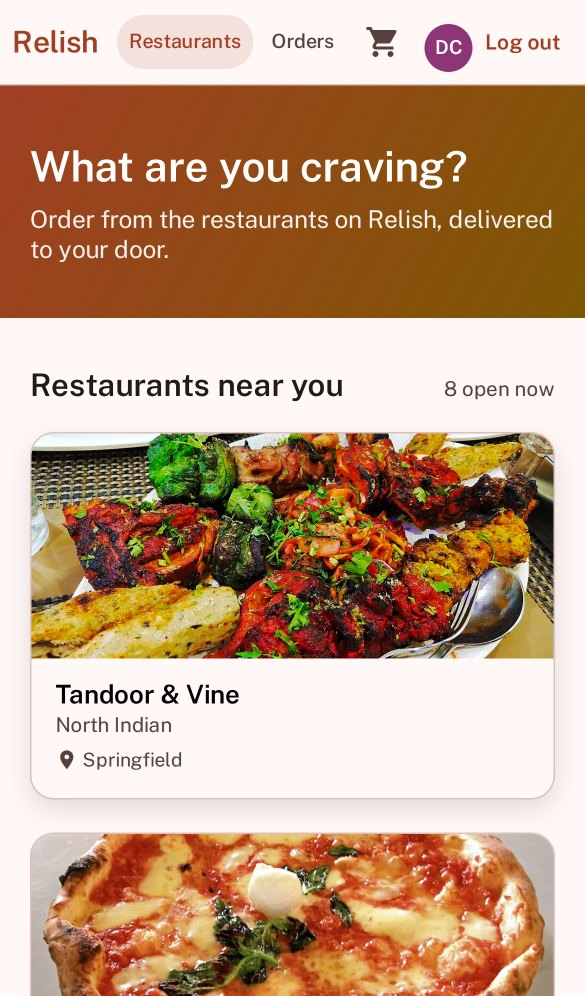
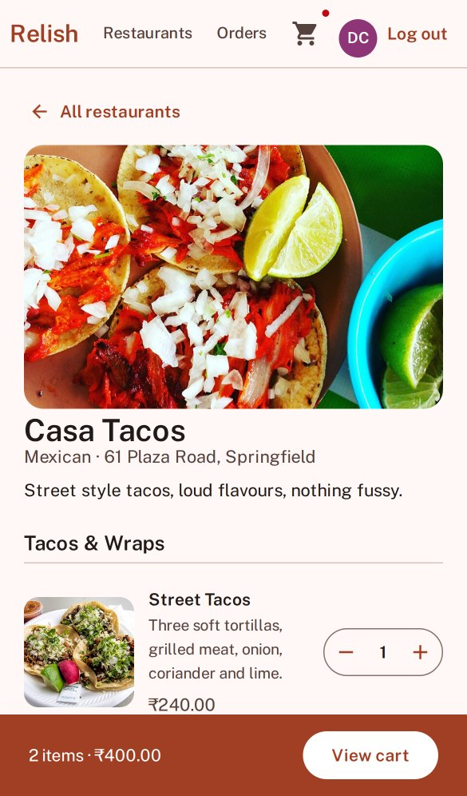

# Relish

Small food delivery app, Angular + Spring Boot, OTP login (no passwords). Built to run entirely in Docker, not meant for production scale, just a demo/exhibition project.

## Screenshots

Restaurant list



Menu and cart



The restaurant sees the order come in



Rider app



Order tracking for the customer



Admin approving restaurants



Login, and a couple of phone screens



<p>
  
  
</p>

## Requirements

Just Docker (Desktop or Engine + compose plugin). No local Node, JDK, Maven or Postgres needed, everything builds and runs in containers.

## Quickstart

```bash
git clone <repo-url>
cd food-delivery-saas
cp .env.example .env
docker compose up
```

Once it is up, open the frontend in your browser. The ports are in `docker-compose.yml` if you need to change them.

## Demo accounts

There's seed data, so you can log in right away. Login is an emailed code, but no email goes out unless you set up SMTP in `.env`, the code just gets printed in the backend log:

```bash
docker compose logs backend | grep "OTP for"
```

| Role | Email |
|---|---|
| Customer | demo@relish.local |
| Restaurant owner | owner@bellacucina.relish.local (every restaurant has an `owner@<name>.relish.local`) |
| Delivery partner | rider@relish.local |
| Platform admin | admin@relish.local |

Any other email signs up as a new customer.

## Tests

```bash
docker compose --profile test run --rm backend-test
```

## Status

All four roles work end to end. Customers order, restaurants run the order queue, riders deliver, and an admin approves new restaurants and accounts. Still to do: a map picker for delivery addresses, and payments.

## License

MIT, see `LICENSE`. The food and restaurant photos come from Wikimedia Commons and keep their own licences, credits are in `CREDITS.md`.
